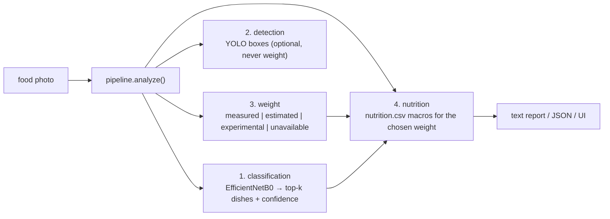

# Project Guide: How FoodMacros Works

This guide explains the project at a **conceptual level**. It is aimed at a
reader who has never seen the code. After reading it, open
`FILE_BY_FILE_REFERENCE.md` for the exact file list.

---

## 1. The problem

Given a photo of food, we want to answer three questions:

1. **What dish is it?** (e.g. `pizza`, `sushi`, `apple_pie`)
2. **How much does the portion weigh?** (grams)
3. **What are the macros for that portion?** (calories, protein, carbs, fat, ...)

This project ships a working answer for (1) and (3), and an honest "no answer"
for (2) unless the user asks for it - because we refuse to invent a weight.

The main model is an **EfficientNetB0** image classifier trained on the
**Food-101** dataset (101 dishes). A separate **food detector** (a YOLO model)
finds where food is in a photo, which enables the *multi-dish* mode.

The design rule that keeps the project trustworthy is:

> **Never guess. If a value is not available, say "unavailable" and explain why.**

---

## 2. The three ways to use the project

All three use the same code underneath (`src/foodmacros`), so behaviour is
consistent.

- **Web app** (`app/gradio_app.py`): the easiest way for a human to use it.
  Two tabs: **Single dish** and **Multiple dishes**.
- **CLI scripts**:
  - `scripts/run_analysis.py <image>` - one dish.
  - `scripts/run_multi_analysis.py <image>` - several dishes on one plate.
- **Python package**: `from foodmacros.pipeline import FoodAnalysisPipeline`
  lets you call the pipeline directly inside your own script or notebook.

---

## 3. The single-dish pipeline

> The diagram below uses Mermaid (renders on GitHub/GitLab). The ASCII version
> after it works in any plain-text viewer.



```
image ──▶ pipeline.analyze() ──▶ report
             │
             ├─ 1. classification  → top-k predicted dishes (+ confidence)
             ├─ 2. detection       → where the food is (boxes), optional
             ├─ 3. weight          → measured | estimated | experimental | unavailable
             └─ 4. nutrition       → macros for the chosen weight
```

Steps in plain words:

1. **Classification** loads `classifier.keras` (the trained EfficientNetB0) and
   predicts probabilities for all **101** dishes. The top *k* are shown with
   their confidence.
2. **Detection** uses the bundled YOLO food detector to draw boxes around food.
   Boxes describe **where** food is - they are *never* interpreted as weight.
3. **Weight** follows a strict order of trust:
   - `measured` - you typed the grams (only this is trusted);
   - `estimated` - a Nutrition5k regressor (not active, because the ~23 GB
     Nutrition5k dataset is not attached);
   - `experimental` - depth camera volume × food density (disabled by default);
   - `unavailable` - otherwise. **No grams are invented.**
4. **Nutrition** looks up the predicted dish in `data/nutrition.csv` and scales
   the per-100 g values to the chosen weight. If no weight is known, it shows a
   clearly-labelled **reference** quantity (default 100 g) - not a predicted
   weight.

`docs/MODELS_DATASETS_AND_METRICS.md` explains the model, the dataset, and the
numbers in detail.

---

## 4. The multi-dish pipeline

A photo of a plate can contain several different foods at once. The multi-dish
pipeline (`src/foodmacros/multi_pipeline.py`) splits them apart:

```
image ──▶ 1. detect food boxes (YOLO)
        ──▶ 2. crop each box (full resolution, small padding)
        ──▶ 3. classify each crop (EfficientNetB0)
        ──▶ 4. look up nutrition per dish
        ──▶ 5. report per-dish rows + plate total
```

- Detection first, then **numbered boxes** are shown on the photo.
- Each box is cropped **at full resolution** (not the downscaled preview) and
  classified separately.
- The user supplies a weight **per dish** (CLI `--dish-grams` or the UI
  **Grams (g)** column). One single weight for the whole plate is only used when
  exactly one dish is detected, because one number cannot be split between dishes.
- **The plate total is shown only when every included dish has a usable weight
  AND nutrition.** Otherwise it prints `unavailable` with a reason, e.g.
  `missing weight for dish 2`. It will not add up reference-quantity macros and
  pretend that is the real plate.

If detection cannot run (e.g. `ultralytics` not installed), the whole image is
treated as a single dish, with a note.

Verified end-to-end on a synthetic composite plate: `--dish-grams "200,100,50,30"`
gave a total of `960 kcal / 380 g`; a blank entry (`--dish-grams "200,,50,30"`)
correctly produced `unavailable (missing weight for dish 2)`.

---

## 5. The modules, one by one

The package lives in `src/foodmacros/`. Each submodule is small, testable, and
independent. They can be mixed and matched in your own code.

### `config.py`
One tree-shaped configuration object. Loads `configs/default.json` strictly -
a typo in the JSON raises an error instead of being silently ignored. Input
paths are `null` by default and filled in at runtime by discovery, so **no
machine-specific paths are hard-coded**.

### `env_checks.py`
Reports the environment (Python version, TensorFlow, GPU, packages), sets up
mixed precision, and gives a default working/output directory.

### `data/` (discovery, splits, preprocessing)
- `discovery.py` scans `/kaggle/input` (on Kaggle) and local `data/` for the
  images, the nutrition CSV, Nutrition5k markers, and detection weights. It
  returns a `ResolvedInputs` object that says exactly what was found and what is
  missing.
- `splits.py` builds train/val/test splits per class with overlap assertions and
  saves `class_names.json`.
- `preprocessing.py` loads/decodes images robustly and builds `tf.data`
  pipelines.

### `classification/` (model, train, evaluate, predict)
- `model.py` builds EfficientNetB0 (+ an optional ViT fusion, off by default).
- `train.py` does the two-stage training: frozen backbone first, then partial
  unfreezing. It saves portable artifacts: `classifier.keras`, `class_names.json`,
  plus a label mapping and config, so the app can reload the model with
  `compile=False`.
- `evaluate.py` computes top-1/top-5 accuracy, a classification report, and a
  confusion matrix.
- `predict.py` is the robust single-image predictor used at runtime.

### `nutrition/` (csv_schema, lookup, portion)
- `csv_schema.py` validates the CSV columns and counts invalid rows.
- `lookup.py` holds `NutritionTable.per_100g(label, strategy)`. Rows are
  resolved by a documented rule (default `nearest_weight`) - never "first row
  wins".
- `portion.py` scales per-100 g values to a chosen gram amount and rounds.

### `weight/` (estimator, regression, depth_model, calibration, volume, density)
- `estimator.py` implements the trust order: measured > estimated >
  experimental > unavailable, with a configurable reliable range.
- `regression.py` parses Nutrition5k metadata and defines a mass/macro
  regressor (not trained locally - the dataset is not attached).
- The `depth_model` / `calibration` / `volume` / `density` modules are the
  experimental depth path, disabled by default.

### `detection/` (yolo_detector, crop, visualize)
- `yolo_detector.py` wraps Ultralytics YOLO. It checks the package is
  installed and verifies class names; problems become a clear `load_error`.
- `crop.py` loads an image at native resolution and crops each detected box
  (with optional padding).
- `visualize.py` draws the numbered boxes shown in the Gradio app.

### `pipeline.py` and `multi_pipeline.py`
The orchestrators. `FoodAnalysisPipeline.analyze()` runs the single-dish
stages; `MultiDishPipeline.analyze()` runs detect → crop → classify → nutrition
and `apply_weights()` recomputes totals from user weights without re-running
detection.

### `reporting.py` and `multi_reporting.py`
Turn results into readable text or JSON. Both share the same honesty notes
(`LIMITATIONS`).

---

## 6. Configuration at a glance

`configs/default.json` holds the default settings:

| Section | A few meaningful defaults |
|---|---|
| `runtime` | seed 42, mode `quick` (1 epoch for smoke testing) |
| `data` | paths `null` = auto-discover at runtime |
| `model` | `efficientnetb0`, input 224, 101 classes |
| `training` | batch 32 base config (the real notebook used 16), label smoothing 0.1 |
| `nutrition` | reference quantity 100 g, nearest-weight duplicate rule |
| `weight` | regression enabled, reliable range 5-2000 g, depth **off** |
| `detection` | `yolo11n.pt`, conf 0.25, iou 0.45, verify class names |
| `ui` | share off (local only), max top-k 3 |

An analysis always prints a **summary of what it found** first, so you can see
which source (model, detector, weights, CSV) was used and which was not.

---

## 7. Design rules (what makes this project trustworthy)

1. **No hard-coded machine paths** - discover at runtime.
2. **No fabricated values** - missing → explicit `unavailable` + reason.
3. **A fixed serving is a labelled reference**, never a predicted weight.
4. **Multi-row nutrition is resolved by a documented rule**, never "first row".
5. **Broad `except` is avoided**; failures carry a clear message.
6. **Per-dish weights in multi-dish mode** - one plate weight is only used for
   a single detected dish.
7. **Plate totals are honest** - shown only when every included dish has a
   usable weight and nutrition.

---

## 8. Honesty notes / known limits

This is a summary; `docs/RUN_AND_TROUBLESHOOT.md` expands on it.

| Area | Status |
|---|---|
| Full pytest suite | Passes: 171 passed, 2 skipped |
| Smoke test (train → save → load → classify → nutrition) | Verified locally |
| Real Food-101 accuracy (74.05% top-1) | Measured in the training notebook, not re-measured here |
| YOLO food detector | Loads and detects real food; **not** COCO classes |
| Nutrition5k mass regression | Not active (dataset absent) |
| Depth-based weight | Experimental, disabled by default |
| Gradio app | Launches locally; public share/hosting not verified |
| Kaggle notebook run | Requires `/kaggle/input` |
| mAP numbers (e.g. "0.775 / 0.802") | **Do not exist anywhere in this project** - not a source to cite |

---

## 9. Where to go next

- `FILE_BY_FILE_REFERENCE.md` - every file, one line each.
- `MODELS_DATASETS_AND_METRICS.md` - accuracy, model architecture, datasets.
- `NOTEBOOK_GUIDE.md` - what each notebook and cell does.
- `RUN_AND_TROUBLESHOOT.md` - commands and troubleshooting.
- `CLEANUP_AUDIT.md` - what could be removed (proposal only).
- `FRIEND_HANDOVER.md` - a one-page submission-ready description.